---
{"dg-publish":true,"permalink":"/project-shattered-loom/project-shattered-loom-player-friendly/player-friendly/cosmology/timeline-of-the-shattered-loom-graphical/","dg-note-properties":{}}
---


# Timeline of the Shattered Loom — Graphical Overview
## The History of the Multiverse Before the Loom-Marked Arrived

> **Viewing Tip:** In Obsidian, toggle **Reading Mode** (Ctrl/Cmd+E) to render diagrams at full width.

---
````mermaid
%%{init: {'theme': 'base', 'themeVariables': { 'fontSize': '12px', 'fontFamily': 'Georgia, serif' }}}%%
flowchart TB
    %% ===== NODES =====
    subgraph PRIMORDIAL[Time Before Time — Age of the Unbroken Tapestry]
        P1[Telara spins Loom of Creation from Void]
        P2[Silent Spindle forged — heart-engine of Time]
        P3[Unified multiverse — visible golden threads]
        P4[Primordial Lords bound into weave]
        P5[Pale Night exists beyond Loom — Abyss opposite]
    end

    subgraph POTENTIAL[Thread of Infinite Potential]
        TP1[Telara weaves Thread of Infinite Potential]
        TP2[Weave destabilizes — Telara weakens, Loom vulnerable]
    end

    subgraph TRIAL[Trial of Asmodeus — Centuries Pre-Shattering]
        T1[Cosmic litigation at Pinnacle of Order]
        T2[Charges: Corruption, Harvesting, Usurpation]
        T3[Asmodeus Defense: Necessity of Tension]
        T4[Verdict: Methods ruled 'metaphysically legal']
        T5[Pact Primeval ratified — Iron Spindle mandated]
        T6[Debate: Preservation vs. Sabotage Theory]
    end

    subgraph SHATTERING[The Shattering — Year 0]
        S1[1. Silent Spindle betrays — twists Thread of Potential]
        S2[2. Primordial Lords assault — tear threads, merge planes]
        S3[3. Great Dreamer arrives — feeds on collapsing weave]
        S4[4. Telara sacrifices self — unravels essence into threads]
        S5[Loom SHATTERS — fragments scattered across reality]
        S6[Telara's consciousness splinters — echoes, visions, Loomwarden]
        S7[Silent Spindle survives — hidden in Astral Sea]
    end

    subgraph AFTERMATH[Immediate Aftermath — Early Fractured Age]
        A1[Planes disconnect — drift in Astral Sea]
        A2[Shatterpoints appear — unpredictable planar rifts]
        A3[Chaos rises — elemental instability, Far Realm footholds]
        A4[Nine Hells harden — Scar of Absolute Order]
        A5[Avernus = Shattered Frontier / planar junkyard]
        A6[Blood War intensifies — Hells bind vs. Abyss unravel]
        A7[Grand Archive founded by The Librarian]
        A8[Hall of Memories preserves Shattering record]
    end

    %% ===== EDGES =====
    P1 --> P2 --> P3 --> P4 --> P5
    P5 --> TP1 --> TP2
    TP2 --> T1 --> T2 --> T3 --> T4 --> T5 --> T6
    T6 --> S1 --> S2 --> S3 --> S4 --> S5 --> S6 --> S7
    S7 --> A1 --> A2 --> A3
    A3 --> A4 --> A5 --> A6
    A6 --> A7 --> A8

    %% ===== STYLING =====
    classDef primordial fill:#1a1a2e,color:#f1c40f,stroke:#34495e,stroke-width:2px
    classDef potential fill:#2c3e50,color:#f39c12,stroke:#34495e,stroke-width:2px
    classDef trial fill:#4a235a,color:#e8daef,stroke:#8e44ad,stroke-width:2px
    classDef shattering fill:#7b241c,color:#fadbd8,stroke:#c0392b,stroke-width:3px
    classDef aftermath fill:#1b4f72,color:#aed6f1,stroke:#2980b9,stroke-width:2px

    class P1,P2,P3,P4,P5 primordial
    class TP1,TP2 potential
    class T1,T2,T3,T4,T5,T6 trial
    class S1,S2,S3,S4,S5,S6,S7 shattering
    class A1,A2,A3,A4,A5,A6,A7,A8 aftermath
````

---

## 📊 Condensed Reference Tables

### Chronological Era Summary

| Era | Years | Defining Characteristic |
|-----|-------|------------------------|
| **Primordial Era** | Time Before Time | Unified multiverse; Telara weaves; Silent Spindle spins Time |
| **Fracturing Begins** | ~1,000–100 Pre-Shattering | Thread of Potential; Asmodeus Trial; Pact Primeval; cracks form |
| **THE SHATTERING** | Year 0 | Spindle betrays; Primordials attack; Dreamer feeds; Telara sacrifices; Loom breaks |
| **Early Fractured Age** | Years 1–500 | Planes separate; Hells harden; Archive/Lodge/Cult founded |
| **Age of Fragments** | Years 500–2,000 | Consortium; Archdevil technocrats; Planar Wars; Halaster; Dragon-Schism; Strahd |
| **Age of Silent Struggle** | Years 2,000–4,500 | Long Silence; Archive expands; Riftborn; Planar Knots; Loomwarden; Asmodeus advances |
| **Gathering Storm** | Years 4,500–Present | Cult peaks; Dreamer's Dragons wake; Shatterpoints surge; Echoes multiply; Spindle moves |

### Major Loom Fragments — Pre-Campaign Status

| Fragment | Origin | Current Status (Pre-Campaign) |
|----------|--------|-------------------------------|
| **Heart of Darkfire** | Crucible Realm shard | Guarded by Darkfire Dragon in Elemental Fire bleed zone |
| **Crimson Weave** | Telara's vitality/blood essence | Anchoring Barovia; Fanes corrupted by Hag Dragon Coven |
| **Spindle of Telara** | Loom's core mechanism | In Librarian's custody; caged in Loomweaver's Atrium |
| **Thread of Infinite Potential** | The thread that broke the Loom | Unknown — rumored with Silent Spindle in Astral Sea |
| **Loomwarden's Fragments** | Scattered Loom pieces | Scattered; many unrecovered; Loomwarden guards/warps |
| **Infernal Spindle Components** | Asmodeus's counterfeit parts | Near-complete in Nine Hells; Final Thread forging in Cania |

### Cosmological Constants — Before vs. After

| Before Shattering | After Shattering |
|-------------------|------------------|
| Single unified multiverse | Fractured Nexus — disconnected planes in Astral Sea |
| Visible destiny threads | Hidden threads; only Loom-Marked perceive |
| Telara actively weaving | Telara fragmented; distributed consciousness |
| Silent Spindle spinning Time | Silent Spindle hidden; Time flows erratically |
| No planar boundaries | Shatterpoints, Planar Knots, bleed zones |
| Balance maintained | Law (Hells) vs. Chaos (Abyss) vs. Entropy (Dreamer) |
| Magic stable | Wild magic surges; planar bleed corrupts spells |
| Death = thread returns to Loom | Death = thread frays; Soulless exist (Barovia) |
| Gods accessible | Gods distant/silent; Avatars rare; Marks = new connection |

---

## 🎭 The Three Competing "Restoration" Philosophies

```mermaid
%%{init: {'theme': 'base', 'themeVariables': { 'fontSize': '14px' }}}%%
graph TD
    A[THE SHATTERED LOOM<br/>Year 0 - Present] --> B[PALE LODGE: RESTORE]
    A --> C[NINE HELLS / ASMODEUS: REPLACE]
    A --> D[CULT / GREAT DREAMER: RELEASE]
    
    B --> B1[Recover ALL fragments]
    B --> B2[Reweave original design]
    B --> B3[Telara's vision: Balance through connection]
    B --> B4[Cost: Requires sacrifice; may be impossible]
    
    C --> C1[Complete Iron Spindle]
    C --> C2[Enforce Absolute Law / Tyranny]
    C --> C3[Asmodeus's vision: Order through control]
    C --> C4[Cost: Free will extinguished; multiverse frozen]
    
    D --> D1[Destroy remaining fragments]
    D --> D2[Embrace fragmentation/entropy]
    D --> D3[Pale Night/Dreamer vision: Freedom through unmaking]
    D --> D4[Cost: Reality dissolves; meaning ceases]
    
    style B fill:#27ae60,color:#fff,stroke:#2ecc71,stroke-width:2px
    style C fill:#8e44ad,color:#fff,stroke:#9b59b6,stroke-width:2px
    style D fill:#e74c3c,color:#fff,stroke:#c0392b,stroke-width:2px
    style B1 fill:#2c662e,color:#fff
    style B2 fill:#2c662e,color:#fff
    style B3 fill:#2c662e,color:#fff
    style B4 fill:#2c662e,color:#fff
    style C1 fill:#4a235a,color:#fff
    style C2 fill:#4a235a,color:#fff
    style C3 fill:#4a235a,color:#fff
    style C4 fill:#4a235a,color:#fff
    style D1 fill:#7b241c,color:#fff
    style D2 fill:#7b241c,color:#fff
    style D3 fill:#7b241c,color:#fff
    style D4 fill:#7b241c,color:#fff
```



---

## 👥 Notable Pre-Campaign Figures

| Figure | Role | Era | Significance |
|--------|------|-----|-------------|
| **Telara** | Prime Weaver | Primordial → Present (fragmented) | Creator of Loom; sacrificed self; distributed consciousness |
| **Silent Spindle** | Heart-Engine / Betrayer | Primordial → Present (hidden) | Spun Time; betrayed Telara; believes it was right |
| **Asmodeus** | Archdevil / Dark Architect | Pre-Shattering → Present | Won Trial; builds Iron Spindle; transmits Absolute Law |
| **Pale Night** | Mother of Demons / Abyss | Primordial → Present | Philosophical opposite to Telara; "Meaning is a cage" |
| **Great Dreamer** | Far Realm Entity | Shattering → Present | Feeds on weave; spawned Apocalypse Dragons |
| **The Librarian** | Archive Keeper | Post-Shattering → Present | Telara's "Inquisitive Shadow"; neutral preserver |
| **Halaster Blackcloak** | Mad Weaver | ~Year 1,200 | Built Undermountain Knot; imprisoned by Spindle |
| **Strahd von Zarovich** | Vampire Lord / Anchor | ~Year 3,200 → Present | Claims Crimson Weave; hardens Barovia via tyranny |
| **Baba Lysaga** | Hag Matriarch | ~Year 3,200 → Present | Commands Hag Dragon Coven; corrupts Barovian Fanes |
| **Vaelis** | Cult Philosopher | ~Year 4,000 | Claims to have witnessed Shattering; "seen reality end and continue" |
| **Loomwarden** | Loom Guardian | ~Year 2,500 → Present | Preserves and warps fragments; eldritch entity |
| **Mephistopheles** | Archdevil of Cania | Post-Shattering → Present | Forging "Final Thread" — unbreakable strand of reality |
| **Levistus** | Archdevil of Stygia | Post-Shattering → Present | Frozen in time-loop ice; holds "backup" of original Loom design |

---

*This timeline represents the "common scholarly consensus" of the Fractured Nexus. Truth is stranger, and the PCs' arrival marks the first time in millennia that all three restoration philosophies have active, Marked champions moving simultaneously.*
