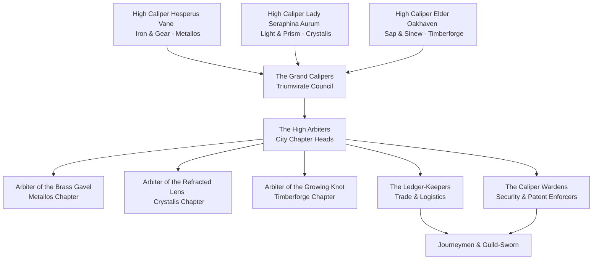

---
{"dg-publish":true,"permalink":"/project-shattered-loom/project-shattered-loom-player-friendly/player-friendly/factions/the-consortium-of-the-gilded-caliper/","dg-note-properties":{}}
---

# The Consortium of the Gilded Caliper

The **Consortium of the Gilded Caliper** (often simply referred to as **The Caliper** or **The Consortium**) is the plane-wide syndicate of master artisans, guilds, and trade administrators that governs the commerce, standards, and secrets of the [[Project Shattered Loom/Project Shattered Loom/Planes of Existence/Outer Planes; Divine Shards/Plane of Eternal Craft/Plane of Eternal Craft Forgeflame Expanse\|Plane of Eternal Craft]]. 

While the plane is a haven for creation, it is also a realm of intense, often obsessive competition. Left unchecked, the rivalry between the foundry-smoke of Metallos, the prismatic studios of Crystalis, and the organic groves of Timberforge would collapse into trade wars and theft of sacred designs. The Consortium was forged to maintain equilibrium, enforce quality, and protect the plane's most valuable asset: craftsmanship.

> _"Measure twice, shape with honor, and let the work outlive the hand."_
> — The Guildmaster's Oath

---

## The Threefold Treaty
The Consortium operates under the **Threefold Treaty**, which guarantees cooperation and regulates the flow of materials between the three great cities of the plane:
1. **The Ore Flow (Metallos to Crystalis & Timberforge)**: The metalworkers provide high-grade metals, alloys, and precision tools.
2. **The Prism Flow (Crystalis to Metallos & Timberforge)**: The glassworkers and jewelers provide focusing crystals, enchanted lenses, and refined light-cores.
3. **The Heart Flow (Timberforge to Metallos & Crystalis)**: The woodcarvers and weavers provide living wood, organic binders, and exotic fibers.

---

## Presence & Guildhalls
The Consortium maintains grand guildhalls in each of the three major cities, serving as local headquarters, trade houses, and neutral zones for artisans.

### 1. The Hall of the Iron Gavel (Metallos)
A massive, brass-domed fortress in the heart of Metallos. It vibrates with the constant humming of subterranean steam pipes and the sound of iron gavels sealing trade contracts. It houses the registry of patents and the vault of technical blueprints.

### 2. The Refractive Dome (Crystalis)
A beautiful glass structure that hovers slightly above the crystalline chasm. The dome shifts colors throughout the day to refract natural light into a spectrum of workspace illumination. It acts as the center for assessing gem quality and licensing magic-infused art.

### 3. The Great Ring-Oak (Timberforge)
A hollowed, living redwood tree that has been shaped over centuries. Rather than using stone or iron, the offices are grown directly out of the branches, connected by suspension walks of woven vines. It regulates the harvesting of living wood and biological components.

---

## Organization & Hierarchy

### 1. The Grand Calipers (The Triumvirate)
The supreme council of the Consortium. Composed of three legendary master artisans representing the three cities, they set plane-wide policies, resolve disputes that threaten the Threefold Treaty, and manage relations with other planes.
* Current members: [[Project Shattered Loom/Project Shattered Loom/NPC's/Hesperus Vane\|High Caliper Hesperus Vane]] (Metallos), [[Project Shattered Loom/Project Shattered Loom/NPC's/Lady Seraphina Aurum\|High Caliper Lady Seraphina Aurum]] (Crystalis), and [[Project Shattered Loom/Project Shattered Loom/NPC's/Elder Oakhaven\|High Caliper Elder Oakhaven]] (Timberforge).

### 2. The High Arbiters (Chapter Heads)
The local administrators who oversee the guildhalls and execute council edicts in each city. They handle guild memberships, resolve local patent disputes, and coordinate city-wide defense.
* Notable figure: [[Project Shattered Loom/Project Shattered Loom/NPC's/Arbiter Valerie Sterling\|Arbiter Valerie Sterling]] of Metallos.

### 3. The Ledger-Keepers (Logistics)
The bureaucrats and merchant coordinators who manage the massive warehouses, calculate tariffs, and supervise the trade routes. They ensure that no single city builds a monopoly on raw materials.

### 4. The Caliper Wardens (Security & Enforcement)
The martial arm of the guild. Led by veteran rangers and fighters, the Wardens protect caravan routes from elemental beasts, hunt down design-thieves, and neutralize rogue creations (such as runaway clockwork titans or mutated living-wood monstrosities).
* Notable figure: [[Project Shattered Loom/Project Shattered Loom/NPC's/Warden-Captain Jaxen Vance\|Warden-Captain Jaxen Vance]].

### 5. Journeymen & Guild-Sworn
The backbone of the guild. Blacksmiths, enchanters, weavers, and alchemists who pay dues in exchange for access to premium materials, workshop spaces, and protection of their intellectual property.

---

## Magic, Aesthetic, & Symbols
* **Aesthetic**: Brass calipers, glowing sapphire runes, pristine blueprints, and measuring instruments. Members often wear a miniature golden caliper as a brooch or pin.
* **Guild Magic**: Focuses on **transmutation** (shaping materials), **abjuration** (protecting workshops and secrets), and **divination** (measuring dimensions, testing purity, and detecting counterfeits).
* **The Mark of the Guild**: A magical seal placed on all items approved by the Consortium. This mark glows faint blue under moonlight and guarantees the item's durability and quality.

---
