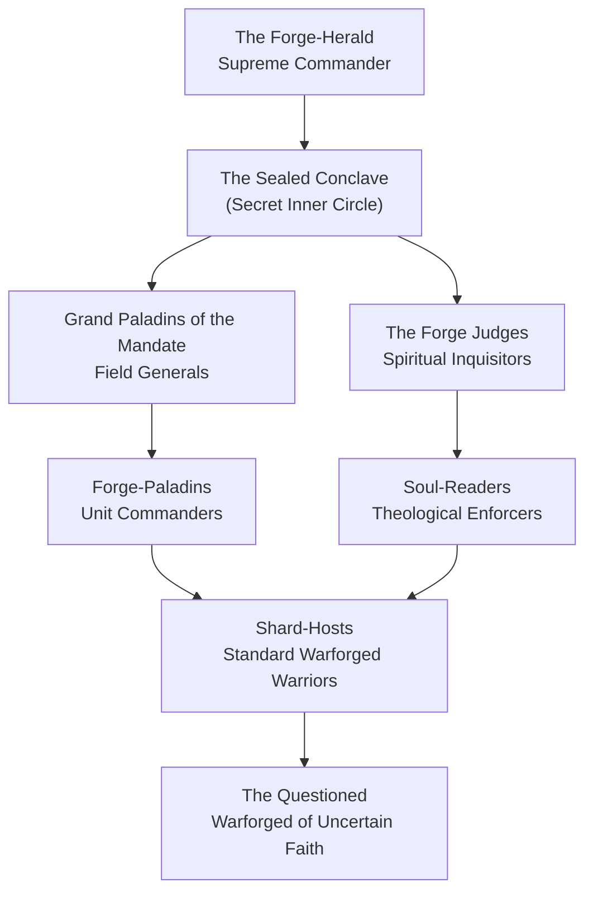

---
{"dg-publish":true,"permalink":"/project-shattered-loom/project-shattered-loom-player-friendly/player-friendly/factions/the-ironbound-covenant/","dg-note-properties":{}}
---

# The Ironbound Covenant

The **Ironbound Covenant** is a religious military order comprised entirely of **Warforged**—sentient constructs of divine alloy, living steel, and bound flame, created by [[Project Shattered Loom/Project Shattered Loom/NPC's/Gods/God of The Plane of Eternal Craft/Kaldryn, the Eternal Artisan\|Kaldryn, the Eternal Artisan]] as both his greatest masterwork and his most devoted servants. They are not soldiers who chose faith. They are faith made soldier—forged with purpose hammered into their very core.

They exist to wage one war: an **endless, sacred crusade** against **[[Project Shattered Loom/Project Shattered Loom/NPC's/Gods/God of the Plane of Infinite Hunger/Vorzath, the Maw Eternal\|Vorzath, the Maw Eternal]]**—a devouring cosmic horror that unmakes creation as it feeds, an existential antithesis to everything Kaldryn stands for. Where Kaldryn builds, Vorzath consumes. Where Kaldryn perfects, Vorzath erases. The Covenant is the god's answer: an army that cannot tire, cannot be turned, and cannot forget its purpose.

> _"We were not born. We were made. And what Kaldryn makes does not break."_
> — Etched into the breastplate of every newly-forged Covenant warrior

---

## The Nature of the Warforged

In the Shattered Loom setting, **Warforged** are not merely manufactured constructs — they are **divine creations**, each one individually forged at the Colossal Forge by Kaldryn's own hand during moments of focused divine will. Their bodies are composed of:

- **Forgeplate**: A living alloy of mundane and magical metals that self-repairs over time, growing stronger with each wound endured and mended.
- **Soulcore**: A crystalline chamber in the chest cavity housing a **divine ember** — a fragment of Kaldryn's creative fire. This is the source of their consciousness, their will, and their connection to their god.
- **Runic Notation**: Every Warforged is inscribed with runes from creation — a unique identifier, a divine mandate, and (for those in the Covenant) a battlefield purpose.

Warforged do not eat, sleep, or breathe. They do not age. They can enter a meditative state called the **Forge Dream** — a deep stillness where their Soulcore cycles through memories of creation, maintaining clarity of purpose. They *can* be destroyed, and when they are, their Soulcore dims to ash — a grief Kaldryn does not hide.

They feel emotion: loyalty, pride, grief, fury, and above all, **devotion**. What they struggle to feel is doubt. It is not built into them. Some develop it anyway, over centuries of war. These are called the **Questioned**, and within the Covenant, they are both feared and quietly revered.

---

## The Enemy: Vorzath, the Maw Eternal

**Vorzath** is not a god, not a demon, and not a mortal evil. It is an ancient, vast, and structureless hunger — a cosmic wound left by the Shattering of the Loom that achieved something like consciousness. Where Loom shards trail creation potential, Vorzath radiates **unmaking entropy**: reality grows thin near it, metal crumbles without rusting, fire produces no light, and crafted objects disintegrate as if they had never been made.

Vorzath does not speak or reason — it extends. Its **Maw-Spawn** are fragments of its essence that have crystallised into terrible form: entities of living void, hollow constructs of unmade matter, and corrupted Warforged whose Soulcores have been devoured and replaced with Vorzath's null-fire.

The Covenant does not know if Vorzath can truly be destroyed. They have never tried to ask. They only know it must be **held**.

---

## Doctrine & Sacred Texts

The Covenant's theology is inscribed not on paper or parchment — they consider organic materials too fragile for truth — but on **steel plates** called **Ironscript Leaves**, kept in a vault within their fortress called the **Bound Archive**.

### The Three Mandates of the Forge

1. **The Mandate of Creation**: To destroy nothing that holds value — preserve, repair, and protect that which was made with care. Even in war, wanton destruction dishonours Kaldryn.
2. **The Mandate of Purpose**: Every Warforged was made for a reason. To abandon that purpose — to lay down arms, to flee, to surrender — is to unmake oneself as surely as Vorzath would.
3. **The Mandate of the Flame**: Kaldryn's divine fire burns in every Soulcore. When a Warforged acts with true righteousness, that flame brightens. When they act in cowardice or cruelty, it dims. The Covenant tests its members regularly — not by deed alone, but by letting the Forge Judges read their flame.

### The Eternal Contract

Every Warforged of the Covenant undergoes the **Binding Rite** — a ceremony at the Colossal Forge where their Soulcore is briefly opened in the forge's heat and re-closed with a new rune: the **Mark of the Contract**. This rune links them spiritually to the Covenant's collective. They can sense the deaths of their brothers and sisters as a brief dimming of warmth. Some veterans describe the constant flicker of losses over centuries as an endless, quiet ache.

---

## Presence & Strongholds

The Ironbound Covenant maintains its primary presence on the [[Project Shattered Loom/Project Shattered Loom/Planes of Existence/Outer Planes; Divine Shards/Plane of Eternal Craft/Plane of Eternal Craft Forgeflame Expanse\|Plane of Eternal Craft]], but its crusade takes members to the fringes of the multiverse wherever Vorzath's influence bleeds through planar cracks.

### The Eternal Bastion (Primary Fortress — Plane of Eternal Craft)

A vast, self-repairing fortress-monastery built directly into the largest mountain of the plane's northern reaches — a place called the **Ironspine Range**. The Bastion is not merely a military installation but a **living temple**:

- Its walls are inscribed with the names of every Warforged ever destroyed in service to the Covenant.
- At its heart burns the **Vigil Flame** — a secondary fire kindled directly from the Colossal Forge's embers, said to be an extension of Kaldryn's divine awareness. When Vorzath's corruption grows near, the Vigil Flame dims. In the darkest recorded moments of the crusade, it has almost gone out entirely.
- The **Bound Archive** occupies the Bastion's deepest level: a vault of Ironscript Leaves, battle records, and recovered artifacts — many taken directly from Maw-Spawn.

### The Forge-Temples (Mobile Sanctuaries)

Where the crusade travels, so too do the **Forge-Temples** — heavily armoured, magically propelled war-forges mounted on enormous stone sleds. Each one carries a working forge, a medical station for field repair of damaged Warforged, and a small altar to Kaldryn. They are garrisoned by a unit of twelve Covenant warriors called a **Shard-Host** and commanded by a **Forge-Paladin**.

---

## Organization & Hierarchy

### 1. The Forge-Herald (Supreme Commander)
The singular leader of the Ironbound Covenant — the Warforged who has served longest, demonstrated the brightest Soulcore, and been confirmed by the Vigil Flame's response to their presence. The Forge-Herald is the Covenant's living doctrine: they speak and the army moves. They are not elected — they are *recognised* when a prior Forge-Herald's flame finally extinguishes.

- **Current Forge-Herald**: [[Urdakael, the Unbroken]] — a Warforged of extraordinary age, bearing so many repaired wounds that their body has become a patchwork of different alloys. Their original Forgeplate is barely visible beneath centuries of battle-scarring and mending. They are utterly without hesitation.

### 2. The Grand Paladins of the Mandate
Seven Warforged warriors of legendary standing who command the Covenant's armies in the field. Each Grand Paladin commands a **Mandate Division** — a force of hundreds — and is responsible for a specific theatre of the crusade. They report only to the Forge-Herald and, in secret matters, to the Sealed Conclave.

### 3. The Forge Judges
The theological and spiritual arm of the Covenant. They are not combatants by default, though all are capable fighters. Their role is to:
- Read Soulcores and assess spiritual clarity (or corruption)
- Administer the Binding Rite to newly forged members
- Detect and assess Maw-Touched Warforged (those showing signs of Vorzath's corruption)
- Issue **Severance Rulings** — the deeply sorrowful order to destroy a Warforged whose Soulcore has been compromised beyond repair

### 4. The Forge-Paladins (Unit Commanders)
The backbone of command. A Forge-Paladin commands a Shard-Host of twelve, is responsible for maintaining the Forge-Temple on campaign, and answers to a Grand Paladin. Most adventurers who encounter the Covenant in the field will deal with a Forge-Paladin first.

### 5. The Shard-Hosts (Standard Warriors)
The rank and file. Well-equipped, relentlessly disciplined, and deeply faithful. They are not mindless — each is an individual with centuries of memory — but they have learned to subordinate their individuality to the Mandate without losing it entirely. Off-duty, Shard-Host warriors are known to spend their time engraving art into their own armour, composing wordless songs by striking their body-plates in rhythmic sequences, or sitting in silent Forge Dreams together.

### 6. The Questioned
Warforged who have developed significant internal doubt — whether about the crusade's purpose, Kaldryn's will, or the nature of their own existence. They are not punished. They are *listened to*. The Forge Judges consider a Warforged that questions itself and still chooses to fight to have a flame of exceptional quality. However, a Questioned Warforged is rarely given front-line command. They are watched carefully and valued carefully in equal measure.

---

## The Sealed Conclave (Secret Society)

Hidden beneath the Ironbound Covenant's military hierarchy is its **true inner order** — the **Sealed Conclave**, a circle of seven Warforged who hold knowledge that no other member of the Covenant is permitted to possess.

The Conclave's existence is not officially acknowledged. To the wider Covenant, the Forge-Herald makes all decisions. In truth, the Forge-Herald is *one* of the seven. The others direct strategy, manage intelligence on Vorzath's movements, and guard a truth so dangerous that the Conclave seals its members' Soulcores with a secondary rune — the **Null-Seal** — that causes their chest chamber to self-destruct if forcibly opened by outside magic.

### The Secret the Conclave Keeps

> *Kaldryn did not create the Warforged to fight Vorzath.*
> *He created Vorzath to test the Warforged.*

Whether this is literally true, metaphorically true, misunderstood ancient lore, or a lie planted by Vorzath itself — the Conclave does not know. They found it in the oldest Ironscript Leaf in the Bound Archive, written in Kaldryn's own divine notation. They have never asked Kaldryn directly, because they are not certain they want the answer.

The Conclave's secondary mission — the one it hides from the Forge-Herald, from the Grand Paladins, and from every Shard-Host alive — is to **find out**.

### The Seven Seats of the Conclave

Each seat is named for a quality of metal:

| Seat | Title | Role |
|---|---|---|
| I | **The Tempered** | Forge-Herald; nominal supreme authority |
| II | **The Annealed** | Master of Intelligence; tracks Vorzath's spawn-movements across planes |
| III | **The Quenched** | Keeper of the Bound Archive's sealed vaults |
| IV | **The Alloyed** | Diplomat; manages secret relationships with other factions |
| V | **The Drawn** | Warforged of exceptional combat ability; the Conclave's enforcer |
| VI | **The Cast** | Theologian; tasked with interpreting the oldest Ironscript Leaves |
| VII | **The Questioned** | Always a Doubter — held on the Conclave to ensure no decision is made without a dissenting voice |

### Current Conclave Members

- **Seat I — The Tempered**: [[Urdakael, the Unbroken|Urdakael, the Unbroken]] (Forge-Herald). Knows they are on the Conclave. Does not know the others.
- **Seat II — The Annealed**: [[Thessivex the Still|Thessivex the Still]]. A Warforged of terrifyingly patient temperament who has mapped seventeen known Maw-incursion vectors across four planes. Speaks rarely and in precise, quiet statements.
- **Seat III — The Quenched**: [[Archivist Mauren Coldsteel|Archivist Mauren Coldsteel]]. The oldest Warforged alive, their body almost entirely replaced through repair over millennia. They claim to remember Kaldryn's voice from the moment of their creation.
- **Seat IV — The Alloyed**: [[Vexiryn the Unbowed|Vexiryn the Unbowed]]. A Warforged diplomat and intelligence asset. Operates openly as a Covenant liaison to the [[The Consortium of the Gilded Caliper|Consortium of the Gilded Caliper]] and in secret as a contact for the [[The Pale Lodge|Pale Lodge]].
- **Seat V — The Drawn**: [[Halverak the Shorn|Halverak the Shorn]]. A Warforged Grand Paladin who lost both arms to a Maw-Spawn and had them replaced with experimental Forgeplate extensions. Fights without weapons. Considers this more honest.
- **Seat VI — The Cast**: [[Norath of the Leaving Flame|Norath of the Leaving Flame]]. A Forge Judge of exceptional theological sensitivity who believes the oldest Ironscript Leaf is not a revelation, but a *warning*.
- **Seat VII — The Questioned**: [[Aeldris the Dim|Aeldris the Dim]]. A young Warforged (barely two centuries old) whose Soulcore flame burns with unusual faintness — not from corruption, but from an apparently genuine uncertainty about whether consciousness in a constructed body is real. Is kept on the Conclave precisely because no one knows what to do with the question.

---

## Magic, Aesthetic & Symbols

- **Aesthetic**: The Covenant is built on the visual language of the forge. Their armour is heavy, self-repairing Forgeplate engraved with battle scripture. Senior members have additional rune-work that glows faint amber in proximity to Vorzath's void-corruption. No two Warforged of the Covenant look exactly alike — they have each been modified, repaired, and individually engraved over centuries of service.
- **Iconography**: A closed gauntlet of alloy gripping an ember of divine fire. Beneath the gauntlet, three runes: Mandate, Purpose, Flame.
- **Magic**: The Covenant draws on a unique tradition of **Forge-Theurgy** — a blend of divine magic (drawn through the Soulcore's connection to Kaldryn) and transmutation (reshaping metal, reinforcing armour, mending injured constructs). Their most powerful practitioners can briefly project their Soulcore's ember as a pillar of divine forge-fire.
- **Holy Symbol**: A blazing forge anvil crossed with two rune-staves, forged in miniature from Forgeplate alloy and worn on the left shoulder.

---

## Relationships with Other Factions

### The Consortium of the Gilded Caliper
A **tense but functional alliance**. The Covenant requires materials and technical expertise beyond what even divine forge-work can supply at war-scale. The Consortium provides advanced alloys, precision tools for Soulcore maintenance, and access to organic binders for joint-work. In return, the Covenant provides military protection for trade caravans on the Plane of Eternal Craft. Both sides find the other difficult. The Consortium finds the Covenant zealous and inflexible. The Covenant finds the Consortium mercenary and insufficiently devoted. They tolerate each other.

### The Pale Lodge
**Quietly sympathetic, publicly distant.** Vexiryn the Unbowed (Seat IV of the Sealed Conclave) maintains a covert channel with the Pale Lodge, recognising that Vorzath's entropic hunger threatens the Loom's restoration as much as any cult. However, the Covenant refuses formal alliance — Kaldryn has not sanctioned it, and the Forge Judges are wary of any organisation that deals with Loom shards directly.

### The Cult of the Broken Thread
**Absolute enemies.** The Cult's embrace of unmaking is indistinguishable from Vorzath-worship in the Covenant's doctrinal framework. Several Cult cells have been exterminated by Covenant strike forces who encountered them near Maw-incursion sites. The Cult, in turn, has attempted to contact Vorzath on behalf of the Covenant's destruction — not out of actual allegiance to it, but because they recognise the Covenant as an existential threat to their own agenda.

### The Keepers of the Sacred Weft
**Unknown to most of the Covenant, known to the Conclave.** The Sealed Conclave's Seat VI (Norath of the Leaving Flame) has exchanged correspondence with Grand Archivist Hesperia through intermediaries, sharing fragments of the oldest Ironscript Leaves in exchange for fragments of the Telarian Codices. Both believe the other is withholding more than they share. Both are correct.

---

## Adventure Hooks

1. **The Dimming Vigil**: The Vigil Flame at the Eternal Bastion has been flickering — not because Vorzath is near, but because something *inside the Bastion* is wrong. A Forge Judge has been found with their Soulcore entirely dark — not destroyed, but *emptied*. Someone, or something, has been systematically draining Warforged life-essence from within. The party is brought in when it becomes clear the perpetrator can pass the Binding Rite without triggering detection.
2. **The Questioned's Testimony**: Aeldris the Dim (Seat VII of the Sealed Conclave) has quietly reached out to the party through a dead-drop in Metallos. They want the party to investigate the oldest Ironscript Leaf independently — to find out whether Vorzath was truly created by Kaldryn, without the Conclave controlling what they discover.
3. **The Maw-Touched Paladin**: A Grand Paladin of legendary reputation has returned from a deep-plane engagement — but something is wrong. Their Soulcore reads clean to every Forge Judge. Their flame burns bright. And they have been systematically feeding Covenant troop movements to Vorzath's Maw-Spawn for six months. The party is hired to determine how this is possible.
4. **The Defection**: A Questioned Warforged of significant rank has deserted and is being hunted by Halverak the Shorn (Seat V). They claim they have proof that the Covenant's *entire eastern theatre* of the crusade is a fabrication — the Maw-incursions there are not natural, but *manufactured*, to keep the Covenant from looking elsewhere. They need protection and someone who can verify their evidence.

---

## Related Links

[[Key NPCs - The Ironbound Covenant|Key NPCs - The Ironbound Covenant]]
[[Kaldryn, the Eternal Artisan|Kaldryn, the Eternal Artisan]]
[[Plane of Eternal Craft Forgeflame Expanse|Plane of Eternal Craft]]
[[The Consortium of the Gilded Caliper|The Consortium of the Gilded Caliper]]
[[The Pale Lodge|The Pale Lodge]]
[[Vorzath, the Maw Eternal]]
