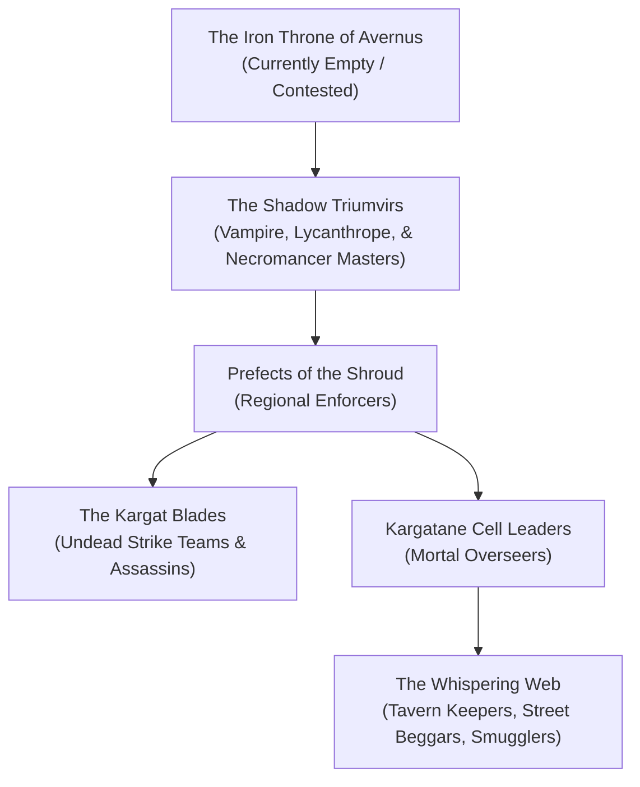

---
{"dg-publish":true,"permalink":"/project-shattered-loom/project-shattered-loom-player-friendly/player-friendly/factions/the-kargat/","dg-note-properties":{}}
---

# The Kargat

The **Kargat** is the dreaded secret police and internal espionage network of the realm of **Darkon**, established centuries ago by the supreme wizard and Darklord **Azalin Rex**. Composed of intelligent undead, cursed lycanthropes, ruthless arcanists, and mortal informants (known as the **Kargatane**), the Kargat maintains iron control over Darkon's crumbling populace and projects Azalin's will across the Mists into neighboring Domains of Dread.

> _"In Darkon, the walls do not merely have ears. They have fangs, claws, and eyes that weep liquid cold. If you whisper a seditious thought at dusk, the Kargat will harvest your skull before dawn."_
> — Common saying in the streets of Il Aluk

---

## Structure & Modus Operandi

While Azalin Rex was trapped within Darkon, the Kargat operated as his omniscient apparatus of state terror. Following the lich-king's disappearance during the catastrophe known as the **Hour of Ascension**, the Kargat fractured into rival factions, each commanded by high-ranking undead warlords vying for dominance over **Castle Avernus**, the city of **Necropolis**, and the sprawling territories of Darkon.

### The Two Tiers of the Network

1. **The True Kargat (The Upper Echelon)**: 
   The inner circle, comprised exclusively of powerful supernatural beings—predominantly **vampires**, **wererats**, **revenants**, and **lichelings**. They operate from shadows, directing assassination squads, conducting forbidden arcane research, and harvesting souls.
2. **The Kargatane (The Mortal Auxiliary)**:
   A vast network of mortal merchants, carriage drivers, tavern barkeeps, and city watchmen. Most Kargatane serve out of desperate ambition, having been promised the gift of eternal life (or freedom from execution) in exchange for continuous reports on outsiders, resistance cells, and unusual planar phenomena.

---

## Organization & Hierarchy

---

## Magic, Aesthetic & Emblems

- **The Symbol**: A gaunt, skeletal hand clutching a closed iron ring, stamped onto wax seals or discreetly branded onto the forearms of inner operatives.
- **Methods**: The Kargat specializes in **memory manipulation**, using cursed tinctures and necrotic enchantments to rewrite the memories of political prisoners, turning them into unconscious double-agents.
- **Mist-Walkers**: High Kargat commanders possess enchanted carriages lined with silver runes capable of navigating the unstable Mists between Darkon, Falkovnia, and Lamordia without succumbing to mist-madness.

---

## Relationships with Other Factions

### Count Strahd von Zarovich & Barovia
**Bitter Planar Rivalry.** Azalin and Strahd shared an ancient, burning hatred. The Kargat continuously attempts to infiltrate Barovian territory to uncover secrets of the Crimson Weave and undermine Castle Ravenloft.

### The Raven Queen & Shadar-kai
**Hostile Encroachment.** The Kargat’s practice of trapping souls in necrotic engines directly offends the Raven Queen. Shadar-kai executioners frequently ambush Kargat soul-caravans.

### The Consortium of the Gilded Caliper
**Black-Market Contracts.** The Kargatane maintains clandestine trade ties with smugglers from the Plane of Eternal Craft, exchanging forbidden necromantic alchemicals and shadow-gems for adamantine chassis and clockwork precision tools.

---

## Adventure Hooks

1. **The Kargatane Coffin**: A carriage bearing the mark of the Kargat breaks an axle outside an inn where the party is staying. The driver flees, leaving behind a lead-lined trunk containing a comatose noble marked with an unstable planar sigil.
2. **The Stolen Grimoire**: Operatives of the True Kargat have infiltrated the Grand Arcaneum of Castle Avernus and stolen a portion of Azalin's research on the Loom Fragments. The party is hired by Archivist Rhaegis to track down the thieves before they escape into the Mists.
3. **Double Agent**: A prominent tavern owner in Darkon reveals to the party that they are a former Kargatane informant desperate to escape, offering crucial information on Castle Avernus's secret passages in exchange for passage out of the domain.

---
[[Shadowfell]]
[[Dorrim Ashvein]]
