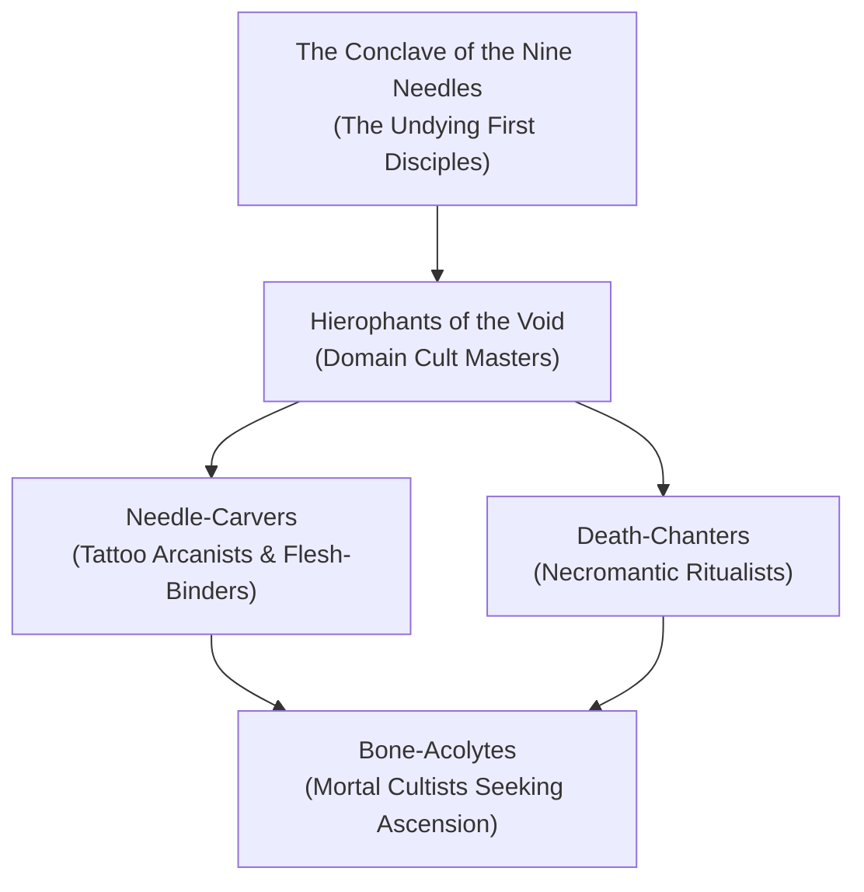

---
{"dg-publish":true,"permalink":"/project-shattered-loom/project-shattered-loom-player-friendly/player-friendly/factions/the-priests-of-osybus/","dg-note-properties":{}}
---

# The Priests of Osybus

The **Priests of Osybus** are an ancient, secretive death-cult of necromancers, blood-scholars, and dark mystics who trace their lineage to **Osybus**, an arch-necromancer who sought immortality through communion with the nameless primordial malevolence known as the **Dark Powers**. In attempting to siphon the eternal life of the dark gods, Osybus was betrayed by his ambitious disciples, who murdered him and harvested his knowledge. Cursed by the Dark Powers for their treachery, the disciples became undying pariahs, doomed to wander the Shadowfell and the Domains of Dread as harbingers of dread transcendence.

> _"Mortality is a brittle thread. The Darklords are imprisoned by their passions, but we are unshackled by our deaths. Every wound sustained is a doorway; every soul drained is another step toward godhood."_
> — High Ritualist Malich of the Ebon Needle

---

## The Nature of the Deathless Cult

In the Shattered Loom setting, the Priests of Osybus represent the most dangerous manipulators of the **Corrupted Weave**. Where the Pale Lodge seeks to mend the Loom and the Ironbound Covenant fights to preserve creation, the Priests of Osybus actively harness the entropic tears in reality to bargain with dark vestiges for personal immortality.

- **Necrotic Boons & Tattoos**: Every Priest of Osybus bears eldritch tattoos carved into their flesh using ink mixed with liquefied shadow and ghoul marrow. These tattoos channel dark magic, allowing them to steal life, mimic vampiric regeneration, and ward off permanent death.
- **The Undying Curse**: When a Priest of Osybus is slain, their soul does not depart to the Outer Planes. Instead, the Dark Powers reknit their flesh within 24 hours at the site of their dark altars, driving them ever closer to complete planar monstrosity.

---

## Organization & Hierarchy

### 1. The Conclave of the Nine Needles
The surviving direct disciples of Osybus. They operate from forgotten catacombs beneath the **Amber Temple** in Barovia, the **Sepulcher District** in Darkon, and ancient desert vaults in **Har'Akir**.

### 2. Needle-Carvers
Masters of magical body modification. They inscribe ritual tattoos upon initiates and darklords alike, trading forbidden boons for soul-tithes and planar secrets.

### 3. Death-Chanters
The combat and ritual arm of the priesthood. They lead incursions into mortal villages, capturing victims to sacrifice at dark monoliths to weaken regional planar barriers.

---

## Doctrine: The Litany of Osybus

1. **Life is Finite, Decay is Eternal**: Reject mortal frailty; bind the soul into the enduring fabric of shadow.
2. **Feed the Dark Powers, Harvest Their Stride**: Serve the Dark Powers just enough to extract their boundless necrotic energy without becoming trapped as a Darklord.
3. **Pluck the Weft**: Seek out fractured nodes of the Loom, for where reality frays, the Dark Powers whisper their deepest secrets.

---

## Relationships with Other Factions

### Count Strahd von Zarovich
**Ancient Catalyst.** It was the Priests of Osybus who originally aided Strahd in unlocking the dark secrets of the Amber Temple, guiding his transformation into the first vampire. Today, Strahd views them as treacherous vermin, while the Priests covertly seek to siphon his bloodline power.

### The Raven Queen & Shadar-kai
**Abhorrent Antithesis.** The Raven Queen despises the Priests of Osybus for desecrating the natural transition of death and enslaving souls through necrotic tattooing. Her Shadar-kai hunt the priesthood without mercy.

### The Cult of the Broken Thread
**Rival Planar Cultists.** Both factions revere the destruction of the natural order, but while the Cult of the Broken Thread worships total cosmic unmaking, the Priests of Osybus want to preserve reality as a diseased hunting ground for their eternal godhood.

---

## Adventure Hooks

1. **The Brand of Osybus**: A noble in Vallaki or Darkon has fallen gravely ill after receiving a mystical protective tattoo from a traveling mystic. The tattoo has begun moving across their flesh, draining their lifeforce to fuel a hidden Osybus altar.
2. **The Amber Temple Infiltration**: A cell of Priests of Osybus has breached the Amber Temple to unseal a sarcophagus containing an ancient vestige of unmaking. The party must beat them to the inner sanctum.
3. **The Living Phylactery**: An operative of the Priests captures an innocent descendant of Osybus to use as a conduit to summon a shadowy titan into the Shadowfell.

---
[[Shadowfell]]
[[The Ulmist Inquisition]]
