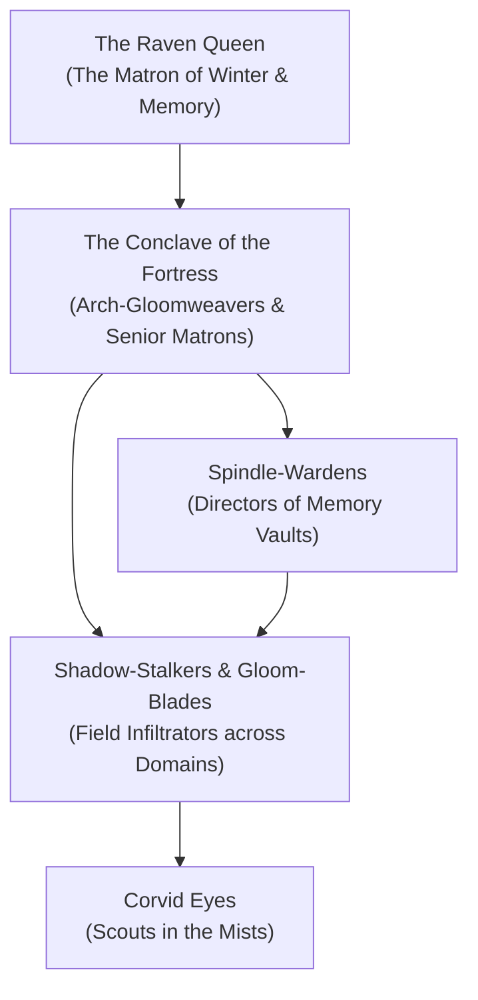

---
{"dg-publish":true,"permalink":"/project-shattered-loom/project-shattered-loom-player-friendly/player-friendly/factions/the-shadar-kai-memory-sworn/","dg-note-properties":{}}
---

# The Shadar-kai Memory-Sworn

The **Shadar-kai Memory-Sworn** are the elite disciples, gloom-weavers, and sacred shadow-operatives of the **Raven Queen**, operating from her seat of power—the **Fortress of Memories**—and deployed throughout every corner of the **Shadowfell** and the **Domains of Dread**. Long ago, the Shadar-kai accompanied their queen into the Shadowfell when she ascended beyond mortal form. Today, they are immortal beings of twilight, their flesh alternating between youthful beauty and withered, skeletal decay depending on the strength of their devotion.

Where the Dark Powers forge prisons of cyclic torment and despair, the Memory-Sworn serve a higher cosmic mandate: **to harvest, preserve, and spin the threads of mortal emotion and memory before they are dissolved into the hungry void of entropy.**

> _"A life is not ended when the heartbeat stops. It ends when the last memory of its love, its triumph, or its sorrow is swallowed by oblivion. We are the shears that gather the yarn."_
> — Matron Varis Gloomweaver, Inquisitor of the Raven Queen

---

## The Nature of the Shadar-kai

In the Shattered Loom setting, the Shadar-kai possess a unique relationship to the **Threads of Destiny**:
- **Gloom-Weaving**: The Shadar-kai can manipulate the dark essence of the Shadowfell, weaving solid shadow into armor, weapons, and slipstreams that allow instantaneous teleportation between shadows.
- **The Memory Harvest**: When a legendary mortal dies or undergoes an emotional rupture, the Memory-Sworn utilize **Spindles of Quenched Silver** to extract the psychic memory from the corpse or living mind, crystallizing it into a shimmering soul-gem called a **Memento Shard**.
- **Cycle of Rebirth**: If slain, a Shadar-kai’s spirit is drawn directly to the Fortress of Memories, where the Raven Queen re-weaves their physical form from shadow and cold memory, granting them functional planar immortality.

---

## Organization & Hierarchy

### 1. The Conclave of the Fortress
The supreme council of elder Shadar-kai residing within the Fortress of Memories. They catalog the millions of memory threads brought back by field agents and present the most significant planar revelations to the Raven Queen herself.

### 2. Spindle-Wardens
Archivists who tend to the crystalline memory pools within the Fortress. They monitor the threads of the multiverse, identifying where Loom fragments are causing localized distortions.

### 3. Shadow-Stalkers & Gloom-Blades
The field operatives who walk the Domains of Dread. Disguised as travelers, mercenaries, or scholars, they infiltrate the courts of Darklords (such as Castle Ravenloft or Castle Avernus) to extract crucial memories, assassinate defilers of the dead, and retrieve stolen planar relics.

### 4. Corvid Eyes
Scouts who coordinate directly with normal ravens, wereravens of the [[The Keepers of the Feather|Keepers of the Feather]], and shadow mastiffs to keep watch over planar crossings.

---

## Doctrine: The Three Laws of the Raven

1. **Accept the Inevitable End**: Death is the natural, sacred closure of all existence; those who artificially stave off death through foul undeath or lichdom defy the cosmic tapestry.
2. **Preserve the Thread**: Though the body must rot and the spirit must pass, the *memory* of the journey belongs to the Raven Queen and must never be obliterated by entropic hunger.
3. **Stand Against the Void**: Oppose Vorzath, the Cult of the Broken Thread, and all powers of absolute cosmic unmaking.

---

## Influence Across the Domains of Dread

While the Darklords believe they hold total dominion over their respective domains, the Raven Queen’s influence subtly permeates every realm through the Memory-Sworn:
- **Barovia**: The Memory-Sworn covertly support the wereravens of the Keepers of the Feather, ensuring that the memories of Tatyana’s past reincarnations are never fully scrubbed by Strahd’s blood magic.
- **Darkon**: Operating within the **Necropolis** and the **Shadowed Bazaar**, they monitor the fractured remnants of Azalin Rex's experiments to ensure his lost knowledge of planar escape does not rupture the plane.
- **Dementlieu & Borca**: Posing as masked courtiers and apothecary suppliers, they harvest the intense memories of political betrayal, passion, and vengeance that fuel the nobility.

---

## Relationships with Other Factions

### The Keepers of the Feather
**Sacred Kinship.** The Memory-Sworn view the wereravens as their beloved cousins and mortal counterparts, frequently sharing safehouses, intelligence, and magical wards.

### The Pale Lodge
**Allied Interest.** Both factions seek the restoration of balance and oppose the unmaking of reality. Memory-Sworn operatives often guide Pale Lodge searchers toward forgotten Loom relics buried in the Mists.

### Count Strahd von Zarovich & The Vampire High-Born
**Contemptuous Enemies.** The vampires view the Shadar-kai as dangerous saboteurs; the Memory-Sworn view the vampires as diseased ticks clinging to stolen lifespans.

---

## Adventure Hooks

1. **The Stolen Memento**: A necromancer in Darkon has stolen a Memento Shard containing the memories of the architect who built the gates of the Fortress of Memories. A Shadar-kai Gloom-Blade hires the party to infiltrate Castle Avernus and retrieve it.
2. **The Raven Queen's Bargain**: A party member plagued by a curse or traumatic memory is visited by a Shadar-kai diplomat who offers to excise the pain into a crystal vial—in exchange for recovering a lost Loom shard from a Darklord's vault.
3. **The Unraveled Crossing**: A shadow crossing leading between the Material Plane and Barovia has begun collapsing under an entropic storm. The party must assist the Memory-Sworn in anchoring the crossing using a silver spindle.

---
[[Shadowfell]]
[[The Keepers of the Feather]]
[[Dorrim Ashvein]]
