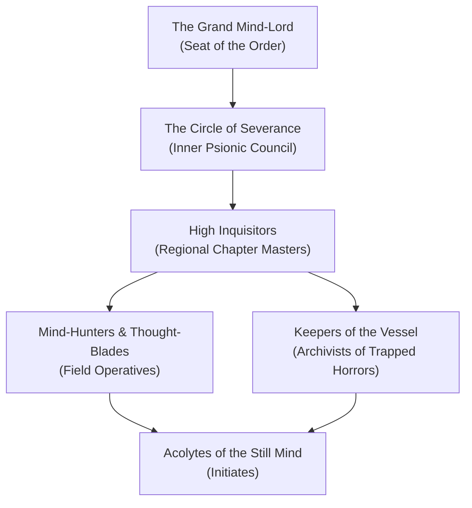

---
{"dg-publish":true,"permalink":"/project-shattered-loom/project-shattered-loom-player-friendly/player-friendly/factions/the-ulmist-inquisition/","dg-note-properties":{}}
---

# The Ulmist Inquisition

The **Ulmist Inquisition** is a formidable order of psionic knights, mind-hunters, and ascetic inquisitors dedicated to the total eradication of aberrant horrors, mind-controlling parasites, and the corrupting vestiges of the **Dark Powers**. Operating across the Domains of Dread and the desolate expanses of the **Shadowfell**, the Inquisition wields weaponized telepathy, psionic blades, and crystalline mind-shields to sever the psychic tendrils through which dark entities enslave mortal minds.

> _"The body can be flayed, the blood harvested, but as long as the mind remains unbowed, the soul belongs to no Darklord. We are the steel in the hollow skull."_
> — High Inquisitor Malenkov of the Ulmist Order

---

## Origins & The Psionic Weft

In the Shattered Loom setting, the Ulmist Inquisition traces its roots to ancient planar mystics who discovered that the mental agony permeating the Shadowfell can be mastered, transmuted, and hardened into a psychic bulwark. When the Loom shattered, mental threads—the fragile connections of intellect and sanity—began snapping into chaotic planar storms. The founders of the Inquisition learned to "knit" their thoughts with crystalline psychic energy, creating a mental discipline known as the **Ulmist Discipline**.

- **Psionic Weaponry**: Inquisitors project weapons of pure mental force—pale violet blades and force-whips that bypass physical plate armor to cleave through the neural pathways of their targets.
- **Thought-Shields**: Every member undergoes grueling psychic conditioning, granting them complete immunity to fear, charm, and memory modification.
- **The Obsidian Mirrors**: Carried by senior Inquisitors, these planar scrying stones can capture and reflect psychic attacks back at the caster.

---

## Organization & Hierarchy

### 1. The Circle of Severance
A council of ancient psionic masters who exist in perpetual shared telepathic communion. They monitor the mental resonance of the Domains of Dread, deploying strike forces wherever an aberrant incursion or Dark Power awakening threatens to rupture planar fabric.

### 2. High Inquisitors
Commanders of fortified chapter-houses across major domains such as **Darkon**, **Falkovnia**, and **Lamordia**. They operate autonomously, coordinating with local militias or acting unilaterally against dark threats.

### 3. Mind-Hunters (Thought-Blades)
The elite combatants of the Inquisition. Trained to hunt vampires, illithids, mind-devourers, and possessed cultists, they strike with surgical precision, severing aberrant telepathic links before quarry can summon reinforcements.

### 4. Keepers of the Vessel
Specialized scholars who maintain lead-lined vaults of **Soul-Jars**—heavy quartz containers holding the trapped psyches of undying horrors that cannot be permanently destroyed.

---

## Doctrine: The Four Iron Axioms

1. **Purge the Mind-Taint**: No mind compromised by aberrant parasites or dark vestige pacts can be permitted to spread its contagion.
2. **Sever the Puppet Strings**: Destroy the controller to liberate the flock. Strike the Darklord, the elder brain, or the vampire master first.
3. **Guard the Loom's Mind**: The thoughts of mortals are the threads that hold reality together. To allow a mind to dissolve into despair is to invite cosmic unraveling.
4. **Trust Only the Unbroken Will**: Magic can be corrupted; blood can be turned; only disciplined thought is incorruptible.

---

## Relationships with Other Factions

### The Raven Queen & Shadar-kai
**Tense Alignment.** The Inquisition respects the Raven Queen's insistence on preserving memories and accepting natural death, but distrusts her servants when they harvest psychic memories without sanitizing the trauma.

### The Keepers of the Feather
**Guarded Distance.** The Inquisitors generally consider lycanthropy a disease of the blood, though they recognize that wereravens remain psychically lucid and often turn a blind eye to their operations.

### The Priests of Osybus & Cult of the Broken Thread
**Mortal Enemies.** The Inquisition considers both organizations to be existential cancers, actively hunting down their ritual circles, burning their soul-caches, and executing their disciples on sight.

---

## Adventure Hooks

1. **The Trapped Psion**: An Inquisitor squad entered Bluetspur to recover a stolen Loom memory lattice from the Elder Brain, but only one member returned, raving about a shattered mindscape. The party is hired to retrieve the team’s Soul-Jars.
2. **The Inquisitor's Accusation**: A High Inquisitor arrives in Vallaki and accuses the burgomaster or a party member of harboring a dark vestige parasite. The party must prove their innocence before psionic executioners strike.
3. **The Cracked Vault**: An earthquake shakes Castle Avernus in Darkon, cracking the seal on an Ulmist containment vault. Scores of captured psychic entities are breaking free into the Shadowed Bazaar.

---
[[Shadowfell]]
[[The Keepers of the Feather]]
